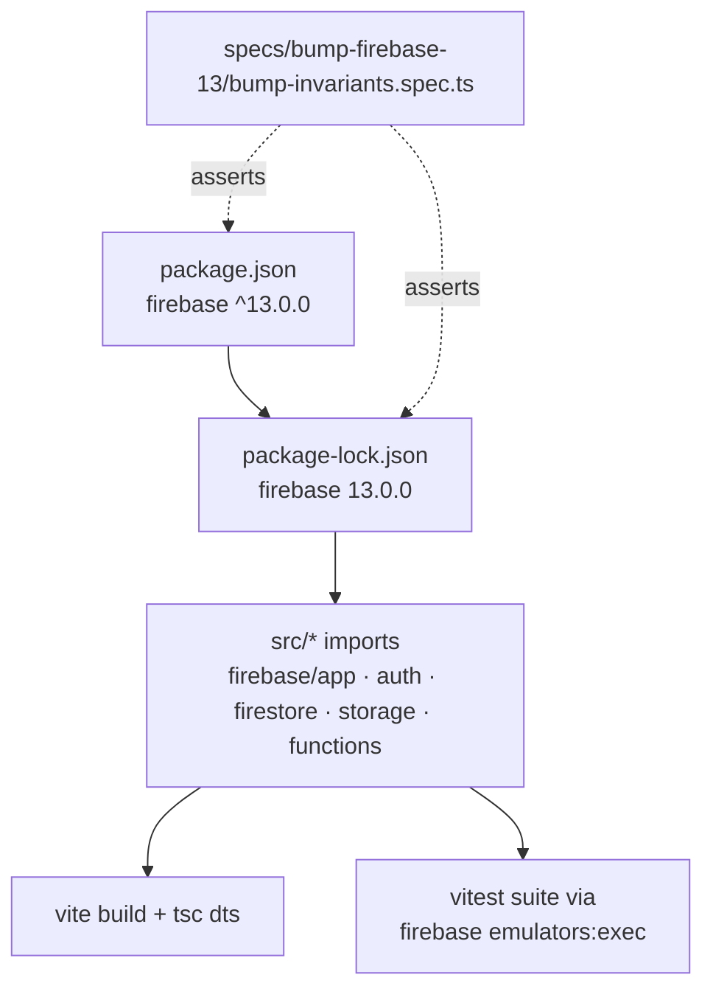

# Bump firebase to ^13 — Design

## Abstract

A pure dependency bump: the `firebase` npm dependency moves from `^12.19.0` to
`^13.0.0` in `package.json` and `package-lock.json`. No production source change is
expected: the v13 major only contains breaking changes in `@firebase/ai`
(`TemplateGenerativeModel`, `VertexAIBackend`, `Part` union — none of which this
project imports), while `app`, `auth` (`1.13.7`), `firestore` (`4.18.0`), `storage`
(`0.14.6`) and `functions` receive patch/minor updates only. An invariant spec
guards the manifest/lockfile so a partial or over-eager bump fails the suite.

## Entities and seams

## Plan

1. Write `specs/bump-firebase-13/bump-invariants.spec.ts` (RED first, per AGENTS.md TDD):
   - REQ-1: manifest declares `firebase: '^13.0.0'`.
   - REQ-2: lockfile root dependency map equals the manifest dependencies and
     `node_modules/firebase` resolves to a `13.x` version.
   - REQ-3: full declared dependency map (dependencies + devDependencies) equals the
     pre-bump map, so any non-firebase bump fails the suite.
2. Set `firebase` to `^13.0.0` in `package.json`, run `npm install` so only the
   firebase subtree re-resolves in the lockfile.
3. Verify: invariant spec green, `npx tsc --noEmit`, `npm run build`, `npm test`
   (emulator suite).

## Proposed changes

| File | Change |
| --- | --- |
| `package.json` | `firebase: ^12.19.0` → `^13.0.0` (nothing else) |
| `package-lock.json` | firebase subtree re-resolved to 13.0.0 |
| `specs/bump-firebase-13/bump-firebase-13.feature` | new — scenarios |
| `specs/bump-firebase-13/bump-firebase-13-design.md` | new — this doc |
| `specs/bump-firebase-13/bump-invariants.spec.ts` | new — executable invariants |

## Best practices

- TDD: invariant spec written and run red before the bump.
- No production code touched — the bump is data, and the data is what the spec asserts.
- Lockfile diff kept minimal by editing the manifest first and letting `npm install`
  re-resolve only the firebase subtree.
- `functions/` dependencies (`firebase-admin`, `firebase-functions`) are out of scope
  and untouched.

## Strengths / weaknesses

- Strength: over-broad bumps (npm re-resolving unrelated deps) become test failures.
- Weakness: REQ-3 pins the exact dependency map, so a future unrelated dep bump must
  update the invariant spec — same trade-off already accepted in
  `specs/merge-dev-master/merge-invariants.spec.ts`.

## Audit notes

Independent audit (code-auditor protocol, re-read from disk):

- **Overview**: the change is data-only — one manifest line plus the mechanical
  lockfile re-resolution of the firebase subtree. Guardrails live in an executable
  invariant spec rather than in review discipline.
- **Files**: `package.json`, `package-lock.json`, `specs/bump-firebase-13/*`.
- **Problem**: none of substance. The only friction point is that REQ-3 pins the
  exact dependency map, so any future unrelated dep bump must update the invariant
  spec alongside it.
- **Solution / Recommendation**: *Worth exploring* — if future dep bumps become
  frequent, derive the "untouched" map by diffing against the base branch in CI
  instead of pinning literals. Not implemented now: it would add git coupling to
  the test runner, and the literal-map approach matches the existing
  `merge-invariants.spec.ts` precedent.
- Post-audit verification: invariant spec 3/3 green, emulator suite 79 passed /
  4 skipped (skips pre-existing), `npm run build` and `npx tsc --noEmit` clean.
